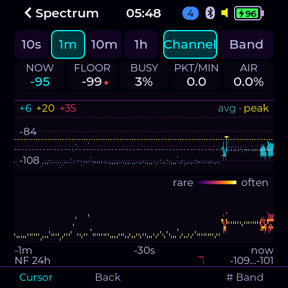
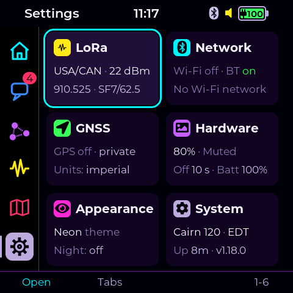

  <picture>
    <source media="(prefers-color-scheme: dark)" srcset="docs/logo/cairn-lockup-stacked.png">
    
  </picture>

**Cairn** is a fork of the [MeshCore](https://github.com/meshcore-dev/MeshCore) companion firmware. Every board is built from one source tree that shares MeshCore's mesh and radio code, and every build works with the official MeshCore apps ([web](https://app.meshcore.nz), [Android](https://play.google.com/store/apps/details?id=com.liamcottle.meshcore.android), [iOS](https://apps.apple.com/us/app/meshcore/id6742354151)).

Builds are numbered: the splash screen shows **BUILD N**, releases are tagged `cairn-vN`, and files are named `MeshCore-<Board>-CairnN-<date>…`, so you can match a device to a release from its own screen.

**Download the files from the [latest release](https://github.com/cvhviz/Cairn/releases/latest).** L1 Pro releases from before Cairn (builds 40 to 98) are archived in this repository's releases; the last of them is [build 98](https://github.com/cvhviz/CAIRN/releases/tag/cvhbuild-v98).

## Latest: Cairn 122 (25 Oct 2026)

- **What the app missed, it gets back** (every companion: the L1 Pro family, T096, L2 Pro, Heltec V4 kits, ThinkNode M9, T-Deck and T-Display SF32; needs CairnOS build 18 or later): the radio keeps a numbered journal of the packets it hears, so the app catches up after a dropped link as far back as the journal reaches (a few dozen to about 100 packets on the L1 Pro family and T096), and a message stays queued on the radio until the app has stored it. Anything the radio had to drop is counted in the app ("Messages Lost on the Radio") instead of vanishing. The official MeshCore apps get the same frames as before.
- **Every radio preset the app offers, on the device** (L2 Pro, Heltec V4 kits, ThinkNode M9, T-Deck, T-Display SF32): all 28 of the app's presets, grouped by region with yours first. The Radio page's summary card shows the path hash next to the TX power.
- **A locate button on the map** (L2 Pro, Heltec V4 touch, ThinkNode M9, T-Deck): it centres the map on your position and follows it; a second tap on the GPS tab does the same. With the GPS off, the map, distances and Home use the position set from the app.
- **A radio change no longer leaves the node deaf** (every board): a preset or frequency change while the radio was listening could leave it hearing nothing until it next sent.
- **The Wi-Fi app link** (L2 Pro, Heltec V4 kits, ThinkNode M9, T-Deck): a phone set to "Always allow" can change the radio settings over Wi-Fi. Command-line text over Wi-Fi is now limited like the other commands, so the app's Reboot, Power off, Set PIN and Wi-Fi commands work over Bluetooth only.
- **TX power:** the caps sit where the amplifier saturates (T096 16; Heltec V4, V4 Kit V1, V4-R8 and Tracker V2 18), every screen shows the power at the antenna, and `set tx` refuses a value out of range. A saved setting above the new cap is lowered at boot, which leaves the output where it was.
- **Repeaters space out their replies to a repeater scan,** so fewer should collide in a busy area.
- **T-Deck under an SD-card launcher:** the online update no longer crashes it ([#28](https://github.com/cvhviz/CAIRN/issues/28)); it says to update from the launcher instead. A T-Deck on Cairn 121 or earlier still runs the old updater, so install `MeshCore-TDeckPlus-Cairn122-2026-10-25-update.bin` from the card once ([T-Deck page](docs/boards/lilygo-t-deck.md#from-cairn-122)).
- **Not yet checked on a device:** nothing new in 122 has run on hardware yet. Every board builds and the firmware's automated tests pass, but RX sync, queue sync, the radio-change fix, radio settings over Wi-Fi and the Wi-Fi command-line limits, the locate button, the device preset picker, the new TX caps and antenna readings (not checked against a meter), the spaced-out scan replies and the launcher refusal on a T-Deck are all untried on hardware. Reports are welcome.
- **Updating:** L2 Pro, Heltec V4 touch, ThinkNode M9, T-Deck and T-Display SF32 update over Wi-Fi in **Settings › System › Firmware update**. The L1 Pro family and the T096 update by copying the new `.uf2` ([UF2 guide](docs/install/nrf52-uf2.md)). Going back to Cairn 121 afterwards loses the messages waiting on the radio for the app.
- **Other boards:** the preview boards stay on [Cairn 107 preview](https://github.com/cvhviz/Cairn/releases/tag/cairn-v107-preview).

Cairn 121 brought Settings pages that fit on one screen, more from the T096's one button, the first Heltec V4 Expansion Kit V1 build and safer saves; see its [release notes](https://github.com/cvhviz/Cairn/releases/tag/cairn-v121).

## Supported boards

✅ **Tested**: used on real hardware before each release. ✅ **Beta**: tested on hardware but new to Cairn; its page lists what hasn't been tried yet. 🧪 **Preview**: builds from the same tree but hasn't been tried on hardware. Reports are welcome.

### nRF52840 (install by copying a `.uf2`)

| Board                                                         | Screen and input               | Status | Install guide                    |
| ------------------------------------------------------------- | ------------------------------ | ------ | -------------------------------- |
| [Seeed Wio Tracker L1 Pro](docs/boards/wio-tracker-l1-pro.md) | OLED or e-ink, joystick        | ✅     | [UF2](docs/install/nrf52-uf2.md) |
| [Heltec Mesh Node T096](docs/boards/heltec-t096.md)           | 0.96" colour TFT, one button   | ✅     | [UF2](docs/install/nrf52-uf2.md) |
| [Preview boards](docs/boards/preview-boards.md)               | OLED or colour TFT, one button | 🧪     | [UF2](docs/install/nrf52-uf2.md) |

The L1 Pro takes the SH1106 OLED, the 2.42" SSD1309 "DV1" OLED or the e-ink display. nRF52840 preview boards: RAK4631, RAK3401, ProMicro, Nano G2 Ultra, Heltec T1, GAT562 boards, Meshtiny, Keepteen LT1, LilyGO T-Impulse Plus.

### ESP32 / ESP32-S3 (install with esptool or a web flasher)

| Board                                                         | Screen and input                      | Status  | Install guide                             |
| ------------------------------------------------------------- | ------------------------------------- | ------- | ----------------------------------------- |
| [Seeed Wio Tracker L2 Pro](docs/boards/wio-tracker-l2-pro.md) | 3.2" touchscreen                      | ✅      | [esptool / web](docs/install/esp32-s3.md) |
| [Heltec V4 + Expansion Kit](docs/boards/heltec-v4-touch.md)   | 2.8" touchscreen                      | ✅      | [esptool / web](docs/install/esp32-s3.md) |
| [Heltec V4 + Expansion Kit V1](docs/boards/heltec-v4-kit-v1.md) | 2.8" touchscreen, no map            | 🧪      | [esptool / web](docs/install/esp32-s3.md) |
| [Elecrow ThinkNode M9](docs/boards/thinknode-m9.md)           | 2.4" screen, keyboard, d-pad          | ✅ beta | [esptool / web](docs/install/esp32-s3.md) |
| [LilyGO T-Deck / T-Deck Plus](docs/boards/lilygo-t-deck.md)   | 2.8" touchscreen, keyboard, trackball | ✅ beta | [esptool / web](docs/install/esp32-s3.md) |
| [Preview boards](docs/boards/preview-boards.md)               | OLED or colour TFT, one button        | 🧪      | [esptool / web](docs/install/esp32-s3.md) |

The L2 Pro, Heltec V4, ThinkNode M9 and T-Deck run the same Cairn interface; the M9 drives it by keys and the T-Deck by touch or keys. The Heltec V4 + Expansion Kit page is for the V4-R8 in the Kit V2; the plain V4 in the Kit V1 has its own untested preview build (from Cairn 121).

ESP32 preview boards: Heltec V4 / V4-R8 / V3 (OLED), Heltec Wireless Tracker (V1, V2), LilyGO T-Beam Supreme and T-Beam 1W, T3S3, Station G2 / G3 (USB build only), XIAO ESP32-S3, ThinkNode M2, Meshnology W12, Ebyte EoRa-S3; and on the original ESP32, Heltec V2, LilyGO T-Beam (SX1262 / SX1276, Bluetooth build only), T-LoRa V2.1-1.6 and MeshAdventurer. The original-ESP32 boards install the same way; the [ESP32 guide](docs/install/esp32-s3.md#original-esp32-boards) has the one difference.

### SiFli SF32 (install with one double-click)

| Board                                                         | Screen and input                   | Status | Install guide                     |
| ------------------------------------------------------------- | ---------------------------------- | ------ | --------------------------------- |
| [LilyGO T-Display SF32](docs/boards/lilygo-t-display-sf32.md) | 480×480 AMOLED touchscreen, keypad | ✅     | [installer](docs/install/sf32.md) |

The T-Display SF32 sits on its 20-key keypad board and runs its own card-based interface. The installer runs on Mac, Windows and Linux.

### Repeaters (compact screen)

| Board                                                             | Screen           | Status  | Install guide                             |
| ----------------------------------------------------------------- | ---------------- | ------- | ----------------------------------------- |
| [Heltec Mesh Node T096](docs/boards/compact-repeater.md)          | 0.96" colour TFT | ✅ beta | [UF2](docs/install/nrf52-uf2.md)          |
| [Heltec T114](docs/boards/compact-repeater.md)                    | 1.14" TFT        | 🧪      | [UF2](docs/install/nrf52-uf2.md)          |
| [Heltec V2, V3, V4, V4-R8](docs/boards/compact-repeater.md)       | 0.96" OLED       | 🧪      | [esptool / web](docs/install/esp32-s3.md) |
| [Heltec Wireless Tracker V1, V2](docs/boards/compact-repeater.md) | 0.96" colour TFT | 🧪      | [esptool / web](docs/install/esp32-s3.md) |

The standard MeshCore repeater with a minimal Cairn screen: Status, Spectrum and a few Settings on the one button, and a power save that keeps the screen and TX LED off until a double-click. Holding the button on Status (~3 s, then release) turns it off; a press turns it back on. The screens below are simulated with fictional sample data.

| | | |
|---|---|---|
|  T096 repeater · Status |  T096 repeater · Spectrum |  T096 repeater · Settings |

Want another board? [Ask for it](https://github.com/cvhviz/Cairn/issues/new?template=board_request.yml).

## Features

| Feature                       |  L1 Pro  | L2 Pro | Heltec V4 touch | ThinkNode M9 |   T-Deck    | T-Display SF32 |   T096   | Preview |
| ----------------------------- | :------: | :----: | :-------------: | :----------: | :---------: | :------------: | :------: | :-----: |
| MeshCore apps over Bluetooth  |    ✅    |   ✅   |       ✅        |      ✅      |     ✅      |       ✅       |    ✅    |   ✅    |
| Input                         | joystick | touch  |      touch      |     keys     | touch, keys | touch, keypad  |  button  | button  |
| Colour emoji                  |    –     |   ✅   |       ✅        |      ✅      |     ✅      |       ✅       |    –     |    –    |
| Wi-Fi                         |    –     |   ✅   |       ✅        |      ✅      |     ✅      |      ✅ ¹      |    –     |    –    |
| Online updates                |    –     |   ✅   |       ✅        |      ✅      |    ✅ ²     |       ✅       |    –     |    –    |
| GPS                           |    ✅    |   ✅   |      ✅ ³       |      ✅      |    Plus     |       ✅       |    ✅    |  some   |
| microSD card                  |    –     |   ✅   |       ✅        |      ✅      |     ✅      |       ✅       |    –     |    –    |
| Offline map                   |    –     |   ✅   |       ✅        |      ✅      |     ✅      |       ✅       |    –     |    –    |
| Map downloads, online map     |    –     |   ✅   |       ✅        |      ✅      |     ✅      |       ✅       |    –     |    –    |
| Spectrum and band scan        |    –     |   ✅   |       ✅        |      ✅      |     ✅      |       ✅       | spectrum |    –    |
| Repeater scan and admin       |    –     |   ✅   |       ✅        |      ✅      |     ✅      |       ✅       |    –     |    –    |
| USB-serial companion          |    –     |   –    |        –        |      –       |      –      |       –        |    ✅    |   ✅    |
| Contact QR code               |    –     |   ✅   |       ✅        |      ✅      |     ✅      |       –        |    –     |    –    |
| Room server image             |    ✅    |   –    |        –        |      –       |      –      |       –        |    –     |    –    |
| Colour themes                 |    –     |   ✅   |       ✅        |      ✅      |     ✅      |       ✅       |    ✅    | some ⁴  |
| Wi-Fi and Bluetooth scanners  |    –     |   ✅   |       ✅        |      ✅      |     ✅      |       ✅       |    –     |    –    |
| Music player                  |    –     |   ✅   |        –        |      –       |    ✅ ⁵     |       ✅       |    –     |    –    |
| Voice recorder                |    –     |  ✅ ⁶  |        –        |      –       |    ✅ ⁵     |       ✅       |    –     |    –    |
| Traffic log, packet details   |    –     |   ✅   |       ✅        |      ✅      |     ✅      |       ✅       |    –     |    –    |
| Spectrum, history to CairnOS  |    –     |   ✅   |       ✅        |      ✅      |     ✅      |       –        |    –     |    –    |
| File manager                  |    –     |   ✅   |       ✅        |      ✅      |     ✅      |       –        |    –     |    –    |
| USB drive (microSD)           |    –     |   ✅   |        –        |      –       |     ✅      |       –        |    –     |    –    |
| IR remote, climate sensors    |    –     |   –    |        –        |      –       |      –      |       ✅       |    –     |    –    |
| Imperial units, 12-hour clock |    ✅    |   ✅   |       ✅        |      ✅      |     ✅      |       ✅       |    ✅    |   ✅    |

¹ Clock sync and online updates; no app link over Wi-Fi. ² From Cairn 108 on. ³ With the Expansion Kit. ⁴ The colour-screen boards (Wireless Tracker, T1). ⁵ From Cairn 113, tried on a T-Deck Plus. ⁶ From Cairn 115.

## Which file do I need?

Each release carries every board's files, named `MeshCore-<Board>-CairnN-<date>[-<variant>].<ext>`. Your board page lists them all.

| You want to…      | nRF52840 boards       | ESP32 boards                         | T-Display SF32                          |
| ----------------- | --------------------- | ------------------------------------ | --------------------------------------- |
| **First install** | the board's `.uf2`    | `-full.bin` at `0x0` ⚠               | the `-install.zip`: unzip, double-click |
| **Update**        | the board's `.uf2`    | `-update.bin` at `0x10000`, or Wi-Fi | the `-install.zip` again, or Wi-Fi      |
| **Recover**       | copy the `.uf2` again | erase, then `-full.bin` at `0x0`     | hold A for 12 s, then the installer     |

- ⚠ An ESP32 first install erases the device. If it runs MeshCore, export your identity and contacts in the app first. Updates keep everything.
- On ESP32 boards, write the `-full.bin` or the `-update.bin`, never both.
- `SHA256SUMS.txt` in each release covers every file: `shasum -a 256 -c SHA256SUMS.txt`.

Install guides: [nRF52840 (UF2)](docs/install/nrf52-uf2.md) · [ESP32 (esptool or web)](docs/install/esp32-s3.md) · [T-Display SF32 (one-click installer)](docs/install/sf32.md)

## Manual, brochure and screens

- [Cairn firmware manual (PDF)](docs/Cairn_Firmware_Manual_Dark.pdf): every board, screen and setting, with the touch, key (M9, T-Deck) and OLED-board ways to do each task, a shortcuts and gestures cheat sheet, troubleshooting and a glossary. Written for Cairn 118; the [Cairn 119](https://github.com/cvhviz/Cairn/releases/tag/cairn-v119), [Cairn 120](https://github.com/cvhviz/Cairn/releases/tag/cairn-v120), [Cairn 121](https://github.com/cvhviz/Cairn/releases/tag/cairn-v121) and [Cairn 122](https://github.com/cvhviz/Cairn/releases/tag/cairn-v122) release notes cover what changed since (the GPS tab opens on the map, Settings' LoRa, Network and GNSS names, Settings pages that fit on one screen, the full preset list and the map's locate button). A web version with search is in [docs/Cairn_Firmware_Manual_Dark](docs/Cairn_Firmware_Manual_Dark) (download the folder and open `index.html`).
- [Cairn brochure (PDF)](docs/Cairn_Wio_L2_Pro_Brochure.pdf): the firmware, the board and the 3D-printed case, in nine pages.
- [Previous manual (PDF)](docs/Cairn_Wio_L2_Pro_User_Manual.pdf): the October 2026 Wio Tracker L2 Pro edition. The offline-map tool it mentions is [tools/maptiles.py](tools/maptiles.py) ([how to use it](tools/MAPTILES.md)).
- The touch features are listed on the [L2 Pro board page](docs/boards/wio-tracker-l2-pro.md). The Heltec V4 touch, ThinkNode M9 and T-Deck run the same interface.

More promo images (free to share) are in [docs/promo](docs/promo). **All 19 screens**, one by one: [L2 Pro board page](docs/boards/wio-tracker-l2-pro.md#screens).

## Screens on other boards

### ThinkNode M9 and T-Deck

The same interface on the [ThinkNode M9](docs/boards/thinknode-m9.md), driven by its keys, and on the [T-Deck](docs/boards/lilygo-t-deck.md), by touch, keyboard and trackball. Captured on the devices.

| | | |
|---|---|---|
|  M9 · Battery |  M9 · Spectrum |  M9 · Quick panel |
|  M9 · Settings |  T-Deck · Home | |

### LilyGO T-Display SF32

The native square interface on the [T-Display SF32](docs/boards/lilygo-t-display-sf32.md), driven by its keypad and touchscreen. Captured on the board, with mesh names blurred. The Settings screen is the one-screen layout from Cairn 121. More on the [board page](docs/boards/lilygo-t-display-sf32.md#screens).

| | | |
|---|---|---|
|  SF32 · Home |  SF32 · Spectrum |  SF32 · Settings |

### Heltec T096

The themed one-button interface on the [T096](docs/boards/heltec-t096.md)'s 0.96" screen, rendered by the firmware's own drawing code in a desktop simulator with fictional sample data. More, including all five themes, on the [board page](docs/boards/heltec-t096.md#screens).

| | | |
|---|---|---|
|  T096 · Home |  T096 · Spectrum |  T096 · Recent |
|  T096 · Night theme |  T096 · Soft theme |  T096 · Radio |

## Reporting a problem

[Open an issue](https://github.com/cvhviz/Cairn/issues/new/choose) and pick **Bug report**. The form asks for the board, the build number from the splash screen, how you installed it, and what happened. A serial log helps a lot. Reports on 🧪 preview boards are especially useful, including "it works".

## Publishing a release (for the online updater)

The L2, Heltec V4 touch (Kit V2 and Kit V1), ThinkNode M9, T-Deck and T-Display SF32 builds read `https://api.github.com/repos/cvhviz/Cairn/releases/latest`. For a build to be offered:

- Tag it `cairn-vN`, where N is the build number shown on the splash (it must be higher than the device's own). Publish it as a normal release, not a draft or prerelease.
- Attach each board's `-update.bin` under its exact name, with nothing between the date and `-update.bin`. The SF32 also accepts a `.sha256` file next to its update.
- GitHub records each file's SHA-256, which the device checks, along with the size and the board's OTA marker inside the image.
- No other asset may start with one of these board prefixes and end in `-update.bin`. Preview boards use their own board names.
- The release notes are shown on the device before installing, so keep the top of them short and plain.

| Board           | Update file                                           |
| --------------- | ----------------------------------------------------- |
| L2 Pro          | `MeshCore-WioL2Pro-CairnN-YYYY-MM-DD-update.bin`      |
| Heltec V4 touch | `MeshCore-HeltecV4Touch-CairnN-YYYY-MM-DD-update.bin` |
| Heltec V4 Kit V1 (untested preview) | `MeshCore-HeltecV4KitV1-CairnN-YYYY-MM-DD-update.bin` (Cairn 122: `MeshCore-HeltecV4KitV1-Cairn122-2026-10-25-update.bin`) |
| ThinkNode M9    | `MeshCore-ThinkNodeM9-CairnN-YYYY-MM-DD-update.bin`   |
| T-Deck          | `MeshCore-TDeckPlus-CairnN-YYYY-MM-DD-update.bin`     |
| T-Display SF32  | `MeshCore-TDisplaySF32-CairnN-YYYY-MM-DD-update.bin`  |

## Relationship to upstream

This is a personal build, not a general-purpose distribution. All core mesh and radio behaviour comes from [MeshCore](https://github.com/meshcore-dev/MeshCore). See that project for protocol documentation, the official flasher, its own list of supported hardware and the client apps. Cairn tracks MeshCore releases; the release notes say which version each build is based on. Credit to the MeshCore developers and community for the foundation.

## License

MIT, same as upstream MeshCore. The firmware embeds third-party fonts, emoji and libraries under their own licences; see [THIRD_PARTY_NOTICES.md](THIRD_PARTY_NOTICES.md) and [licenses/](licenses/).
