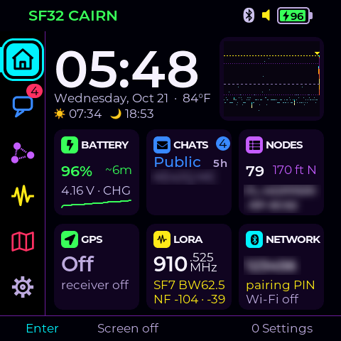

<p align="center">
  <picture>
    <source media="(prefers-color-scheme: dark)" srcset="docs/logo/cairn-lockup-stacked.png">
    
  </picture>
</p>

**Cairn** is a fork of the [MeshCore](https://github.com/meshcore-dev/MeshCore) companion firmware with its own on-device interface: a full touch interface on the larger screens, and compact ones for small screens and repeaters. Every board is built from one source tree that shares MeshCore's mesh and radio code, and every build works with the official MeshCore apps ([web](https://app.meshcore.nz), [Android](https://play.google.com/store/apps/details?id=com.liamcottle.meshcore.android), [iOS](https://apps.apple.com/us/app/meshcore/id6742354151)).

**[Download the latest release](https://github.com/cvhviz/CAIRN/releases/latest)** · [Files for every board](docs/downloads.md) · [Install guides](#install-and-update) · [Manual (PDF)](docs/Cairn_Firmware_Manual_Dark.pdf) · [Report a problem](#reporting-a-problem)

<!-- Bump this section with each cairn-vN release. Nothing else in this README names the current build. -->
## Latest release: Cairn 125 (29 Oct 2026)

- **LilyGO T-LoRa Pager joins the release** (✅ beta), with online updates: a Pager on the Cairn 124 test build finds 125 in Settings › System › Firmware update. Its [page](docs/boards/lilygo-t-lora-pager.md) has the controls and what has been checked.
- **T-LoRa Pager fixes:** the microSD card mounts and Maps works again ([#34](https://github.com/cvhviz/CAIRN/issues/34)), and the side wheel is calm at a slow turn and fast when spun. Checked on a Pager, apart from the card.
- **Heltec V4 + Expansion Kit V1:** the same memory fix as the Pager (its PSRAM was left unused at start-up).
- **Heltec T096: "Storage low" only when a contacts save really failed** ([#32](https://github.com/cvhviz/CAIRN/issues/32)). It used to show from about 150 contacts with a third of the space still free.

[Cairn 125 release notes](https://github.com/cvhviz/CAIRN/releases/tag/cairn-v125) · [all releases](https://github.com/cvhviz/CAIRN/releases)

## Download

Every board's files are in the **[latest release](https://github.com/cvhviz/CAIRN/releases/latest)**, under **Assets**. GitHub lists them in alphabetical order, so look for your board's name. Every file is named

```
MeshCore-<Board>-Cairn<N>-<date>[-<variant>].<ext>     for example MeshCore-WioL2Pro-Cairn125-2026-10-29-update.bin
```

The splash screen shows **BUILD N**, so you can match a device to its release. `SHA256SUMS.txt` in each release covers every file: `shasum -a 256 -c SHA256SUMS.txt`. The **[downloads page](docs/downloads.md)** lists every file for every board, including the preview and experimental builds.

### Which file do I need?

| You want to…      | nRF52840 boards (`.uf2`) | ESP32 boards (`.bin`)                     | T-Display SF32                          |
| ----------------- | ------------------------ | ----------------------------------------- | --------------------------------------- |
| **First install** | the board's `.uf2`       | `-full.bin` at `0x0`, after an erase ⚠    | the `-install.zip`: unzip, double-click |
| **Update**        | the board's `.uf2`       | over Wi-Fi, or `-update.bin` at `0x10000` | over Wi-Fi, or the `-install.zip` again |
| **Recover**       | copy the `.uf2` again    | erase, then `-full.bin` at `0x0`          | hold A for 12 s, then the installer     |

- ⚠ An ESP32 first install erases the device. If it runs MeshCore, export your identity and contacts in the app first. Updates keep everything.
- On ESP32 boards, write the `-full.bin` or the `-update.bin`, never both.
- Boards with two companion builds have a `-ble` file (phone app over Bluetooth, the usual one) and a `-usb` file (app over USB serial). Files with `-repeater` in the name are the [compact repeater](docs/boards/compact-repeater.md).

### Supported boards

✅ **Tested**: used on real hardware before each release. ✅ **Beta**: tested on hardware but new to Cairn; its page lists what hasn't been tried yet. 🧪 **Preview**: built from the same tree but not yet tried on hardware. **Experimental**: a one-off test build ([what that means](docs/experimental.md)). Reports on 🧪 and experimental boards are especially welcome, including "it works".

#### LilyGO

| Board | Screen and input | Status | Files (`MeshCore-<Board>-…`) |
| --- | --- | --- | --- |
| [T-Deck / T-Deck Plus](docs/boards/lilygo-t-deck.md) | 2.8" touchscreen, keyboard, trackball | ✅ beta | `TDeckPlus`: `-full.bin`, `-update.bin` |
| [T-LoRa Pager](docs/boards/lilygo-t-lora-pager.md) | 2.33" wide screen, keyboard, side wheel | ✅ beta | `TLoraPager` (SX1262), `TLoraPagerLR1121`: `-full.bin`, `-update.bin` |
| [T-Display SF32 + keypad board](docs/boards/lilygo-t-display-sf32.md) | 480×480 AMOLED touchscreen, keypad | ✅ | `TDisplaySF32`: `-install.zip`, `-update.bin` |
| [T-Beam, T-Beam Supreme, T-Beam 1W, T3S3, T-LoRa V2.1-1.6, T-Impulse Plus](docs/boards/preview-boards.md) | OLED (optional on some), one button | 🧪 | in [Cairn 107 preview](https://github.com/cvhviz/CAIRN/releases/tag/cairn-v107-preview) |

#### Seeed

| Board | Screen and input | Status | Files (`MeshCore-<Board>-…`) |
| --- | --- | --- | --- |
| [Wio Tracker L2 Pro](docs/boards/wio-tracker-l2-pro.md) | 3.2" touchscreen | ✅ | `WioL2Pro`: `-full.bin`, `-update.bin` |
| [Wio Tracker L1 Pro](docs/boards/wio-tracker-l1-pro.md) | OLED or e-ink, joystick | ✅ | `WioL1Pro`, `DV1`, `WioL1Eink`, `WioL1RoomServer`: `.uf2` |
| [SenseCAP MeshPager X2](docs/experimental.md) | colour screen, d-pad | experimental | `MeshPagerX2`: in its [experimental releases](https://github.com/cvhviz/CAIRN/releases?q=meshpager-x2&expanded=true) |
| [XIAO ESP32-S3, XIAO ESP32-S3 + Wio-SX1262](docs/boards/preview-boards.md) | optional OLED, one button | 🧪 | in [Cairn 107 preview](https://github.com/cvhviz/CAIRN/releases/tag/cairn-v107-preview) |

The L1 Pro has three companion builds, one per screen (the stock SH1106 OLED, the 2.42" SSD1309 "DV1" OLED and the 2.13" e-ink), and a room server.

#### Heltec

| Board | Screen and input | Status | Files (`MeshCore-<Board>-…`) |
| --- | --- | --- | --- |
| [V4-R8 + Expansion Kit V2 (touch)](docs/boards/heltec-v4-touch.md) | 2.8" touchscreen | ✅ | `HeltecV4Touch`: `-full.bin`, `-update.bin` |
| [V4 + Expansion Kit V1 (touch)](docs/boards/heltec-v4-kit-v1.md) | 2.8" touchscreen, no map | 🧪 | `HeltecV4KitV1`: `-full.bin`, `-update.bin` |
| [Mesh Node T096](docs/boards/heltec-t096.md) | 0.96" colour TFT, one button | ✅ | `HeltecT096`: `-ble.uf2`, `-usb.uf2` |
| [Mesh Node T096 repeater](docs/boards/compact-repeater.md) | 0.96" colour TFT, one button | ✅ beta | `HeltecT096`: `-repeater.uf2` |
| [T114, V2, V3, V4, V4-R8, Wireless Tracker V1 and V2 repeaters](docs/boards/compact-repeater.md) | TFT or OLED, one button | 🧪 | `HeltecT114`: `-repeater.uf2`; the ESP32 boards `-repeater-full.bin`, `-repeater-update.bin` |
| [V2, V3, V4, V4-R8 (OLED), Wireless Tracker V1 and V2, T1 companions](docs/boards/preview-boards.md) | OLED or colour TFT, one button | 🧪 | in [Cairn 107 preview](https://github.com/cvhviz/CAIRN/releases/tag/cairn-v107-preview) |

Check which Heltec V4 you have before installing: the touch build for the Expansion Kit V2 needs a **V4-R8** (8 MB PSRAM), and a standard V4 (2 MB PSRAM) in the Kit V1 needs the Kit V1 build. The [V4 touch page](docs/boards/heltec-v4-touch.md) says how to tell.

#### Elecrow ThinkNode

| Board | Screen and input | Status | Files (`MeshCore-<Board>-…`) |
| --- | --- | --- | --- |
| [ThinkNode M9](docs/boards/thinknode-m9.md) | 2.4" screen, keyboard, d-pad | ✅ beta | `ThinkNodeM9`: `-full.bin`, `-update.bin` |
| [ThinkNode M2](docs/boards/preview-boards.md) | OLED, one button | 🧪 | in [Cairn 107 preview](https://github.com/cvhviz/CAIRN/releases/tag/cairn-v107-preview) |

#### Other boards (🧪 preview)

RAK4631, RAK3401, ProMicro, B&Q Nano G2 Ultra, Station G2 and G3 (USB build only), GAT562 30S Mesh Kit, Mesh Tracker Pro and Mesh Watch13, Meshtiny, Keepteen LT1, Meshnology W12, Ebyte EoRa-S3 and MeshAdventurer. They run the one-button interface from the T096 and are in [Cairn 107 preview](https://github.com/cvhviz/CAIRN/releases/tag/cairn-v107-preview), an older build than the current release. [Preview boards](docs/boards/preview-boards.md) lists each one's files.

Want another board? [Ask for it](https://github.com/cvhviz/CAIRN/issues/new?template=board_request.yml).

## Install and update

| Chip | Boards | Install guide |
| --- | --- | --- |
| nRF52840 | L1 Pro family, T096, T114 repeater, nRF52840 preview boards | [UF2: double-tap Reset, copy the file](docs/install/nrf52-uf2.md) |
| ESP32-S3, ESP32 | L2 Pro, Heltec V4 touch kits, ThinkNode M9, T-Deck, T-LoRa Pager, ESP32 repeaters and preview boards | [esptool or the web flasher](docs/install/esp32-s3.md) |
| SiFli SF32 | T-Display SF32 | [one-click installer for Mac, Windows and Linux](docs/install/sf32.md) |

- **Over Wi-Fi:** the L2 Pro, both Heltec V4 touch kits, ThinkNode M9, T-Deck, T-LoRa Pager and T-Display SF32 update themselves from the latest release in **Settings › System › Firmware update**, after you confirm. The new build starts on trial and goes back to the old one by itself if it fails to start.
- **Everything else** updates the way it was installed: copy the new `.uf2`, or write the `-update.bin` at `0x10000`. Repeaters and preview boards don't update over Wi-Fi.
- Updates keep your identity, contacts, channels and settings.

## Features

Cairn runs one of four interfaces, depending on the board:

- **The Cairn touch interface** on the L2 Pro, Heltec V4 touch kits, ThinkNode M9 and T-LoRa Pager (by keys) and T-Deck (by touch or keys): a home dashboard, chats with an on-screen keyboard and colour emoji, nodes, repeater scan and admin, spectrum and band scan, offline and online maps, Wi-Fi and Bluetooth scanners, and online updates. The [L2 Pro page](docs/boards/wio-tracker-l2-pro.md#features) lists it all.
- **A native square interface** on the T-Display SF32, with most of the same tools plus its sensors, IR remote, music player and voice recorder.
- **The one-button interface** on the T096 and the preview boards, with themes on colour screens; and the OLED and e-ink interface on the L1 Pro.
- **The compact repeater:** the standard MeshCore repeater with a minimal Status, Spectrum and Settings screen.

[Feature comparison by board](docs/features.md)

## Manual and screens

- [Cairn firmware manual (PDF)](docs/Cairn_Firmware_Manual_Dark.pdf): every board, screen and setting, with the touch, key (M9, T-Deck) and OLED ways to do each task, a shortcuts and gestures cheat sheet, troubleshooting and a glossary. It was written for Cairn 118; the release notes since then ([119](https://github.com/cvhviz/CAIRN/releases/tag/cairn-v119) to [125](https://github.com/cvhviz/CAIRN/releases/tag/cairn-v125)) cover what changed: the GPS tab opening on the map, Settings' LoRa, Network and GNSS names, Settings pages that fit on one screen, the full preset list and the map's locate button. A web version with search is in [docs/Cairn_Firmware_Manual_Dark](docs/Cairn_Firmware_Manual_Dark) (download the folder and open `index.html`).
- [Cairn brochure (PDF)](docs/Cairn_Wio_L2_Pro_Brochure.pdf): the firmware, the L2 Pro and its 3D-printed case, in nine pages.
- [Previous manual (PDF)](docs/Cairn_Wio_L2_Pro_User_Manual.pdf): the October 2026 Wio Tracker L2 Pro edition. The offline-map tool it mentions is [tools/maptiles.py](tools/maptiles.py) ([how to use it](tools/MAPTILES.md)).
- Promo images, free to share: [docs/promo](docs/promo).

[](docs/promo/01_cairn_hero.jpg)

| | | |
|---|---|---|
| <br>[ThinkNode M9](docs/boards/thinknode-m9.md#screens) · Spectrum | <br>[T-Display SF32](docs/boards/lilygo-t-display-sf32.md#screens) · Home | <br>[Heltec T096](docs/boards/heltec-t096.md#screens) · Home |

Every board page has its own screens; all 19 touch-interface screens are on the [L2 Pro page](docs/boards/wio-tracker-l2-pro.md#screens). Screens use fictional sample data, or have mesh names blurred.

## Experimental builds

One-off test builds, such as a new board before it has been on the bench, are GitHub pre-releases tagged `experimental-<board>-<N>`. They may not work, and the online updater never offers them. Current: **Seeed SenseCAP MeshPager X2** (Cairn 124 tests). The LilyGO T-LoRa Pager started there and is in the releases from Cairn 125. What they are, how to flash one and how to send a log: [Experimental builds](docs/experimental.md) · [all experimental releases](https://github.com/cvhviz/CAIRN/releases?q=experimental&expanded=true).

## Older builds

- Earlier Cairn releases: [all releases](https://github.com/cvhviz/CAIRN/releases).
- Wio Tracker L1 Pro builds from before Cairn (builds 40 to 98) are archived as pre-releases tagged `cvhbuild-v*`: [all archived builds](https://github.com/cvhviz/CAIRN/releases?q=cvhbuild&expanded=true). The last of them is [build 98](https://github.com/cvhviz/CAIRN/releases/tag/cvhbuild-v98).

## Reporting a problem

[Open an issue](https://github.com/cvhviz/CAIRN/issues/new/choose) and pick **Bug report**. The form asks for the board, the file you flashed, the build number from the splash screen, how you installed it, and what happened. A serial log from boot (USB, 115200 baud) helps a lot. Reports on 🧪 preview boards are especially useful, including "it works".

## Relationship to upstream

This is a personal build, not a general-purpose distribution. All core mesh and radio behaviour comes from [MeshCore](https://github.com/meshcore-dev/MeshCore); see that project for protocol documentation, the official flasher, its own list of supported hardware and the client apps. Cairn tracks MeshCore releases, and each release's notes say which version it is based on. Credit to the MeshCore developers and community for the foundation.

How releases are tagged and named for the online updater: [Release format](docs/releases.md).

## License

MIT, same as upstream MeshCore. The firmware embeds third-party fonts, emoji and libraries under their own licences; see [THIRD_PARTY_NOTICES.md](THIRD_PARTY_NOTICES.md) and [licenses/](licenses/).
