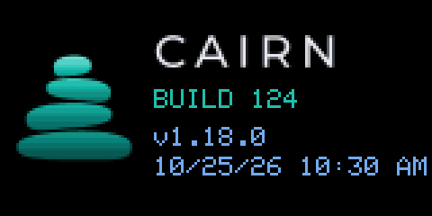
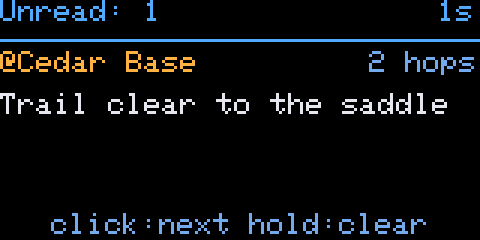
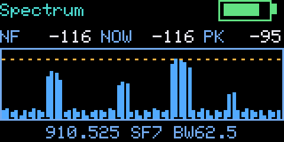
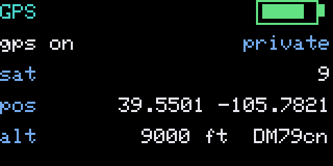
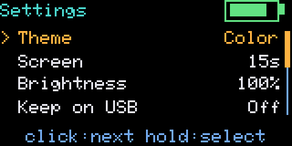
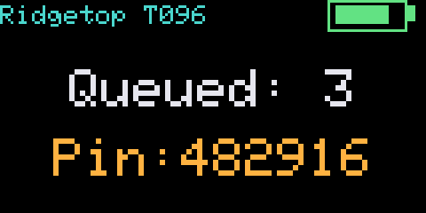
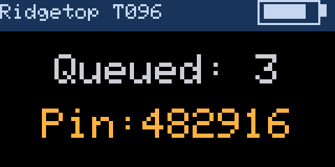
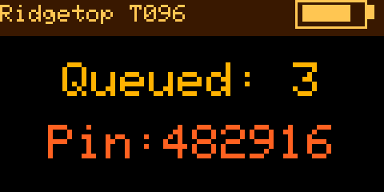
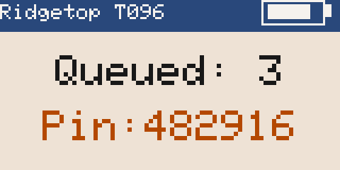
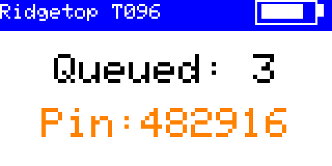

# Heltec Mesh Node T096

✅ Tested on hardware · nRF52840 · [install with UF2](../install/nrf52-uf2.md)

nRF52840, SX1262 LoRa, 0.96" 160×80 ST7735 colour TFT, one button and GPS. Cairn runs a themed one-button interface on it ([screens](#screens)). For a repeater on this board, see [Compact repeater](compact-repeater.md).

## Which file

| You want… | File |
|---|---|
| the companion over Bluetooth (phone app): **the main build** | `MeshCore-HeltecT096-CairnN-<date>-ble.uf2` |
| the companion over USB serial (no Bluetooth, no GPS page) | `MeshCore-HeltecT096-CairnN-<date>-usb.uf2` |

Install, update and recovery all use the same file: double-tap **RST** and copy the `.uf2` onto the drive that appears ([details](../install/nrf52-uf2.md)). Updating keeps your identity, contacts, channels and settings, including the theme.

## Buttons

| Button | Does |
|---|---|
| the button, short press | next page |
| the button, hold | the page's action (for example, send an advert on the Spectrum page); Reboot and Hibernate arm on the first hold and act on a second |
| the button, triple-click | back to the messages page from any page or the message preview (from Cairn 121) |
| the button, hold during the first 8 s after boot | open the rescue console |
| RST | restart; **double-tap** for the UF2 drive |

## Features

- Themes: Dark, Color, Night, Soft and Stock (Settings > Theme).
- Spectrum page with a scrolling RSSI history and NF / NOW / PK readouts.
- Radio page: the frequency in MHz with the TX power, SF / BW / CR in the theme's accent, and the noise floor (from Cairn 111).
- GPS page: fix, satellites and HDOP, position, altitude and the Maidenhead grid square (from Cairn 111).
- Settings: one list in groups: Theme, Screen, Keep on USB, then Bluetooth, then GPS, then a line before Reboot and Hibernate, with Back last (regrouped in Cairn 113).
- Recent shows nodes whose clock isn't set yet (a freshly flashed T096 repeater, for example), labelled "unset" (from Cairn 113).
- TX power is shown at the antenna: the T096 has an amplifier, so a setting of 22 was really about 28 dBm. The setting stops at 16, where the amplifier is already at full output (from Cairn 122; 18 from Cairn 116).
- Messages waiting for the phone app survive a reset, a flat battery or a reflash (from Cairn 119; before, only a commanded restart or power-off kept them).
- **From Cairn 122** (files `MeshCore-HeltecT096-Cairn122-2026-10-25-ble.uf2` and `-usb.uf2`):
  - **RX sync and queue sync** (with CairnOS build 18 or later): the app catches up on what the radio heard during a dropped link, as far back as its 4 KB journal reaches (a few dozen to about 100 packets), and a message stays queued on the radio until the app has stored it; anything the radio had to drop is counted in the app. The official MeshCore apps get the same frames as before. Going back to Cairn 121 loses the messages waiting for the app.
  - **No longer deaf after a preset change from the app:** a radio change while listening left the receiver on the old settings until the T096 next sent. The radio is now set and re-armed in one pass, and the stuck-receiver check also switches the front end back to receive.
  - **TX power:** the setting stops at 16 (was 18), where the amplifier saturates at about 28 dBm; a saved 17 or 18 is lowered to 16 at boot, with the same output. The default of 9 now reads 23 dBm at the antenna (it read 22). `set tx` answers an error outside -9 to 16 instead of saving it.
  - **Not yet checked on a device:** nothing new in 122 has run on hardware yet, including RX sync, queue sync, the re-arm fix, the TX cap of 16 and the 23 dBm reading (not checked against a meter). They build and pass the firmware's automated tests.
- **From Cairn 121** (files `MeshCore-HeltecT096-Cairn121-2026-10-21-ble.uf2` and `-usb.uf2`):
  - **More from the one button:** a hold on the messages page sends an advert, or brings the message preview back while it still holds messages (the hint at the bottom says which). A triple-click goes back to the messages page from any page or the preview.
  - **New in Settings:** Share pos (whether adverts carry your position), Flood advert (a confirming hold, like Reboot), LNA and Boost RX (the receive switches; the Radio page shows both), Msg wake (Off keeps the screen dark when a message arrives), Brightness (100, 60, 30 and 10 %) and GPS Eco (Settings › GPS and a hold on the GPS page step Off, On and Eco: a fix every 10 minutes, off in between; BLE build only).
  - **Message preview:** who and where ("@Cedar Base" or "#Hiking"), the route ("direct" or "2 hops"), the text wrapped in up to four lines. A click goes to the next message, a hold clears them all, a double-click goes back with the messages kept.
  - **Recent** shows all 16 heard nodes, four at a time (a hold steps on; the title says "Recent 5-8/11"), with hop counts. The **Radio** page shows the last packet heard: age, RSSI and SNR.
  - **Low-battery power-off:** under 3.35 V for about 30 s on battery, it saves and powers off instead of browning out (`set lowbatt` changes the level, `set lowbatt 0` turns it off). After Hibernate, a press of the button turns it back on.
  - **Storage low** shows on the messages page when the contacts can't be saved safely; contacts, settings and channels are now written to a copy first.
  - **A quicker screen with less drain while dark:** only the changed lines are sent, on the faster SPI bus, and the BLE build advertises once a second after its first 30 s.
  - **Fixed:** hop counts read "2 hops", not "(66)"; "Queued: 3" in place of "MSG: 3"; "Bluetooth off" in place of a pairing PIN; the battery icon follows a Li-ion curve and no longer dips with each send.
  - **Not yet checked on a device:** Brightness (needs a meter), GPS Eco, the low-battery power-off and the button wake from Hibernate, Storage low, the battery icon against a meter, and the drain with the screen dark.
- Cairn splash in your theme's colours, with the build number.
- Feet and °F, 12-hour clock.

## Screens

The companion build with the default Color theme. These were rendered by the firmware's own drawing code in a desktop simulator, exactly as the panel draws them (shown at 3×), with fictional sample data.

| | | |
|---|---|---|
|  Splash |  Home |  Message |
|  Recent |  Spectrum |  Radio |
|  GPS |  Settings |  Settings · Reboot armed |

### Themes

| | | |
|---|---|---|
|  Color (default) |  Dark |  Night |
|  Soft |  Stock | |

## Known issues

- The USB build has no Bluetooth and no GPS page by design.
- Check each build's release notes for anything new.

Problems? [Report a bug](https://github.com/cvhviz/Cairn/issues/new?template=bug_report.yml).
